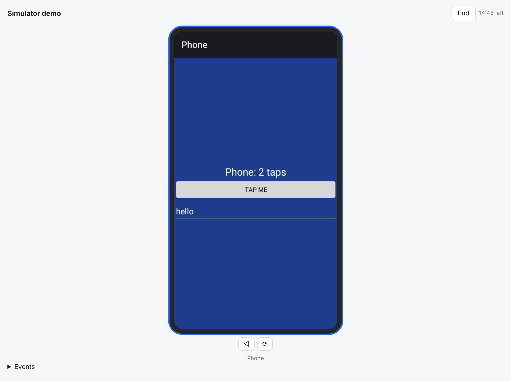
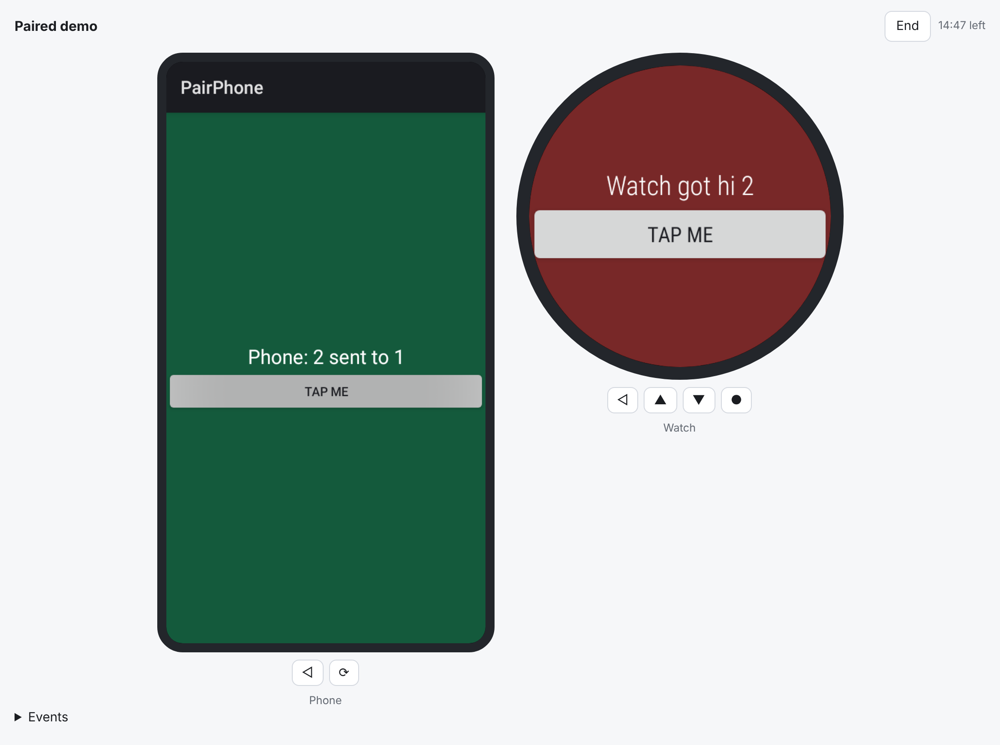
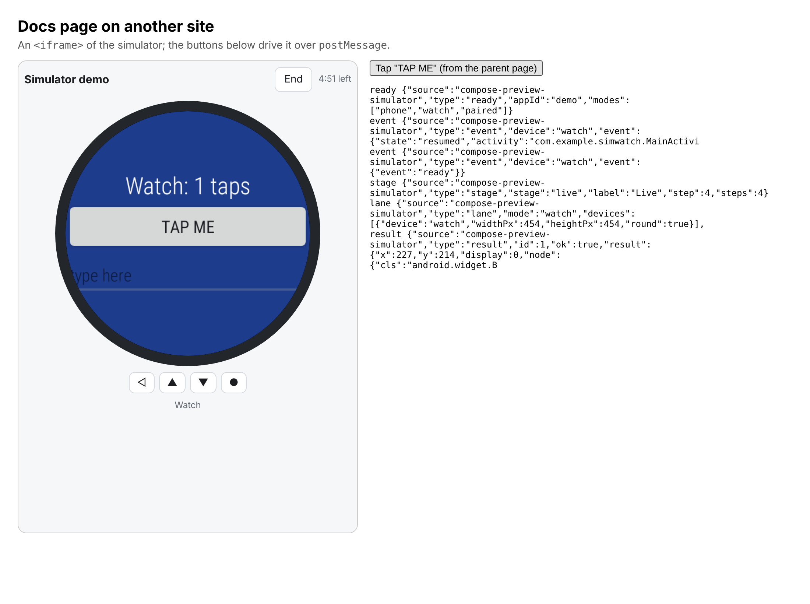

# Running registered APKs in the simulator: sessions, cost, and embedding

## Decision

The server runs operator-registered Android apps in compose-ai-tools' Robolectric simulator and
streams them to a browser as interactive sessions: a **phone**, a **watch**, or **both paired** over
the simulated Wearable Data Layer. A person drives a session on this server's page
(`/simulator/<app>`), an agent drives it over REST, and a third-party site can **embed** it in an
iframe and script it with `postMessage`.

It is off unless the deployment turns it on (`features.simulator`), because a registered app's code
runs on this host.

Implementation: `SimulatorApps.kt` (registry), `SimulatorControlPolicy.kt` (what a client may send),
`SimulatorRuntime.kt` (the CLI process), `SimulatorSessions.kt` (the pool: lifecycle, capacity, idle
tiers, embed tokens), `ServeSimulatorRoutes.kt` (HTTP + socket), `ServeSimulatorPage.kt` (the viewer).

## How the server reaches the simulator

The server starts simulators itself, through `AppSimulatorLauncher` in
[`yschimke/android-simulator`](https://github.com/yschimke/android-simulator)'s published
`ee.schimke.composeai:simulator-launch` (`LauncherSimulatorRuntime`): one simulator JVM per device
and no CLI JVM between them, which saved about 85 MB a session over running
`compose-preview android-simulator --control stdio`. The launcher converts and caches each APK by
content (the CLI's cache and stamp), runs the two JVMs of a pair over a Data Layer hub, and answers
each device's commands by id. Its command vocabulary is the simulator's own (`docs/SIMULATOR.md`
there); none of it is restated here.

It runs from an `android-simulator` distribution: `simulator.home`, else `ANDROID_SIMULATOR_HOME`,
else the image's `/opt/android-simulator`. The image lays that out as links to its own
`lib-simulator/`, `lib-dex2jar/` and `lib-daemon-android/`, so nothing is shipped twice and the
simulator runs on the very jars the watch-face renderer does. Converted APKs are cached under the
state directory, the one path a jailed converter can write.

Every child JVM, the converter's and each simulator's, gets a **clean environment** (`PATH`, `HOME`,
`LANG`, `TZ`, `JAVA_HOME`, `ANDROID_HOME`), through the launcher's `AppSimulatorHost.processBuilder`:
the server's holds operator secrets, and the app can read its own environment.

## Security model

Robolectric is not a sandbox: the app's code runs in an ordinary JVM on this host. Four lines follow:

1. **Only registered APKs run.** A session names an app id, never an APK. `PUT
   /admin/simulator/apps/{app}/apks/{phone|watch}` is the operator token's alone. The registry checks
   the APK (a zip with a binary manifest and dex), refuses a watch app in the phone slot and the
   reverse, and warns when a pair's packages differ (the Data Layer delivers only between the same
   package, on a device and in the simulator).
2. **Clients send an allowlist, never the raw channel.** The simulator's own control channel writes
   and reads host files (`screenshot path`, `files`, `pick files`, `update apk`, `snapshotData`),
   runs `shell`, and exits on `quit`. `SimulatorControlPolicy` forwards a command only when it names
   it for the caller's tier, with only the arguments named for it, each type- and range-checked; no
   kept argument is a host path. Viewers (a page, an embed) get input and reading what is on screen;
   the operator tier (the admin token, an agent testing the app) adds app and device state:
   permissions, network, `startActivity`, notifications, logcat dumps, the Data Layer, battery,
   location. Results and events pass through `redact`, which drops path-valued keys and any string
   naming a host directory; viewers see only listed events and fields.
3. **A session is a capability.** Its 32-byte secret, returned only to its starter, is required by
   its socket and every per-session route, whatever else the route checks.
4. **Optional jail.** `simulator.sandbox` takes the playground's profiles (`unshare`, `bwrap`,
   `systemd`, `strict`, `custom:`) and wraps the CLI process tree in it, with the state directory the
   one writable path (the CLI's home and conversion cache, so conversions persist). The argv and
   environment are built and unit-checked; **a jailed simulator has not been run end to end yet** —
   rehearse it on the deployment before relying on it.

Access to start a session, per app (`config.access`): `operator` (default) or `signed-in` (any
signed-in account, viewer tier). Embeds are governed by `config.embed` alone (below).

## The session protocol

`POST /api/simulator/v1/apps/{app}/sessions {"mode":"phone|watch|paired"}` → `201` with `sessionId`,
`secret`, `socketPath`, `statusPath`, `commandPath`, `screenshotPath`. Then:

- Socket `…/sessions/{id}/ws?secret=…`. Server → client: `stage` (queued with `queueAhead`,
  starting, converting, booting, live, paused, hibernated, failed), `lane` when live (devices with
  their display size and `round`, `launcher`, the commands this tier may send), `frame` per device
  (`composeai-stream/1`'s frame plus `device`, only when the picture changed), `event`, `result`,
  `ended`. Client → server: `command` (`{"type":"command","cmd":"touch","action":"down","x":…,"y":…,
  "device":"watch"}`; with an `id` it is answered), `visibility`, `wake`, `requestFrame`.
- `POST …/commands` (header `X-Simulator-Session-Secret`): one command, answered — the agent's route.
- `GET …/screenshot?device=watch`: the current PNG.

The viewer streams a drag as `touch down/move/up` (moves coalesced to one per animation frame),
turns the wheel into the watch crown (`rotary`) or a phone swipe, typing into `text` and editing keys
into `key`, and shows Back, Home (with a launcher), Rotate (phone) and crown and side button (watch).

## Cost: measured

On the released CLI 2.104.0, a 4-core, 16 GB sandbox, Java 21, hand-built test apps (a phone app, a
watch app, and a phone + watch pair using `play-services-wearable` `MessageClient`). Server path
numbers come from `SimulatorE2ETest`, then on the CLI (the pool's own `/proc` meter,
[`evidence/simulator/e2e-results.json`](../evidence/simulator/e2e-results.json)); the breakdown and
concurrency rows from a harness on the CLI directly.

| | Ready | RSS | Idle CPU | Paused CPU | Wake from pause | Wake from hibernation |
| --- | --- | --- | --- | --- | --- | --- |
| Phone | 5.2–5.8 s | 528–610 MB | 10–15% of a core | **0** | 53 ms | 5.8 s |
| Watch | 5.0 s | 540–590 MB | 8–10% | **0** | 39 ms | 5.6 s |
| Paired | 7.0–8.0 s | 1.0–1.06 GB | 16–21% | **0** | 61 ms | 8.6 s |

- **Where the memory is**: the CLI's own JVM ~85 MB; each simulator JVM ~455 MB for a trivial app,
  and `--max-heap 512m` does not lower it — it is Robolectric's native and class-metadata footprint,
  not heap. Real Compose apps add several hundred MB (the CLI's docs cite ~1 GB for Confetti).
- **A viewer at 4 fps** costs ~10 more points of a core per device (20% phone), screenshots 30–50 ms
  p95, ~15–25 KB PNGs for these screens.
- **Four phones at once on 4 cores**: steady state scales linearly (each 0.2 core at 4 fps, latency
  unchanged), but **booting together took 12.5 s each instead of 5 s**, and one first tap took
  0.9 s. Boots, not running sessions, are what contend.
- First conversion of an APK is a one-off per build (0.3 s here; ~40 s for a large app); cached by
  content across sessions and restarts.

So a session open in a browser but unused costs memory, never CPU, once paused; and memory is the
resource that bounds a host.

## Cost: what the pool does with it

- **Boots are queued**, `maxConcurrentBoots` (half the cores) at a time; the rest wait as `queued`,
  shown with their position.
- **Admission is by memory**, not count: each running session is charged its measured RSS (or, before
  the first sample, the running average for that app and mode, seeded at 900 / 800 / 1700 MB), against
  `simulator.memoryBudgetMb` (default half the machine). `simulator.maxSessions` (default 8) is a
  ceiling on top. An app larger than the whole budget is refused up front.
- **Idle is tiered**:
  1. *Live*: frames are pulled only while a page is visible, at an adaptive rate — every 100 ms for
     2 s after input, 300 ms to 15 s, then 1 s — and deduplicated, one screenshot per device however
     many viewers.
  2. *Paused* (`SIGSTOP` of the tree): when no page has shown it for 10 s, or nobody has touched it
     for 2 minutes. **0% CPU**, memory kept, back in ~50 ms on any input or when the page shows
     again. Never while a command is running.
  3. *Hibernated*: when memory is short for a new or waking session, the least recently used paused
     session nobody is looking at saves each device's top activity state (`savedState`) and its
     process ends. The next touch re-queues it, boots it (~6–9 s) and recreates the activity from that
     state: what `rememberSaveable`, `onSaveInstanceState` and `SavedStateHandle` hold comes back;
     `ViewModel`s and in-memory state do not, as after process death on a device.
  4. *Ended*: no input for 10 minutes, past the app's `maxSessionMinutes`, or no viewer and no request
     for 60 s.
- **Fairness**: an owner holds at most two sessions (a new one replaces their oldest: a reload, a
  second tab); an embedded app at most its `maxConcurrentSessions`; each client address six embed
  starts per ten minutes; the queue eight.
- **Sharing**: the conversion cache and `android-all` are shared on disk; frames are shared between
  every viewer of a session.
- `GET /admin/simulator/capacity` reports budget, charged memory, running / live / booting / paused /
  hibernated / queued counts, total CPU and the per-app estimates; `GET /admin/simulator/sessions`
  each session's RSS, CPU, pauses and hibernations.

**Capacity, worked**: a 16 GB, 4-core host lending the simulator 8 GB holds about 13 trivial or 8 real
phone sessions, or 4–7 pairs, *at once*; CPU allows ~20 actively viewed phones. With pausing and
hibernation, many more can be *open*: the budget bounds the running ones, and an idle tab costs a
hibernated session's bookkeeping until touched. A popular public instance should size memory for its
concurrently *active* users and let hibernation absorb the rest, at the cost of a ~6–9 s wake.

## Embedding in other pages

`/simulator/embed/{app}` is the same viewer, framed by other sites under three controls:

1. **The app opts in** with its exact parent origins: `config.embed = {enabled, origins:
   ["https://docs.example.com"], anonymous, maxSessionMinutes (default 5), maxConcurrentSessions}`.
   The page sets its own CSP with `frame-ancestors <origins>` (and `connect-src 'self'`,
   `form-action 'none'`), so only those origins can frame it; the edge's `X-Frame-Options` skips this
   path.
2. **Who may start**: with `anonymous: false` (default) the embedding site's *backend* mints a
   short-lived HMAC token with the admin token — `POST /admin/simulator/apps/{app}/embed-tokens
   {"ttlSeconds":900}` → `{token, embedPath}` — and renders the iframe with it; the token is bound to
   the app, expires (≤ 1 h), and leaves the iframe's address bar on load. With `anonymous: true`
   anyone viewing an allowed page may start one, bounded by the per-app concurrency, the per-address
   rate and the short lifetime.
3. **Viewer tier only**: an embed never gets operator commands.

The embed shows a **Run** button rather than booting on load, so a page view costs nothing until
someone asks. Its parent may script it, from its listed origin only:

```js
const sim = document.querySelector('iframe');   // src: https://server/simulator/embed/demo?token=…&mode=watch
sim.contentWindow.postMessage({target: 'compose-preview-simulator', type: 'start', mode: 'watch'}, origin);
sim.contentWindow.postMessage({target: 'compose-preview-simulator', type: 'command', id: 1,
                               cmd: 'tap', args: {text: 'TAP ME'}}, origin);
window.addEventListener('message', (e) => { /* e.data.source === 'compose-preview-simulator':
  ready, stage, lane, event, result {id, ok, result|error}, ended */ });
```

That is enough for docs that walk a reader through an app ("tap Sign in"), or a store page that
offers "try it".







## Findings for compose-ai-tools

- A `tap` issued right after a paired boot, while the app's `getConnectedNodes()` task is still
  pending, waited the full command timeout (60 s): the CLI's settle waits on the app's pending GMS
  task. Waiting for the phone's Data Layer to list its peer first avoids it.
- `find` matches whole texts only; a substring or regex selector would help agents.
- Density: each session pays an ~85 MB CLI JVM, and each simulator JVM ~455 MB of mostly class
  metadata. A render-host `AppSimulatorLauncher` (as `DwfSimulatorLauncher` is for watch faces) would
  remove the former; an AppCDS archive of the simulator classpath could share much of the latter
  between JVMs and shorten boots.

## Not done

- Jailed runs end to end (above).
- Hibernation keeps state in memory: a server restart ends every session.
- Audio, camera and sensors are whatever the simulator offers; the viewer shows the screen only.
