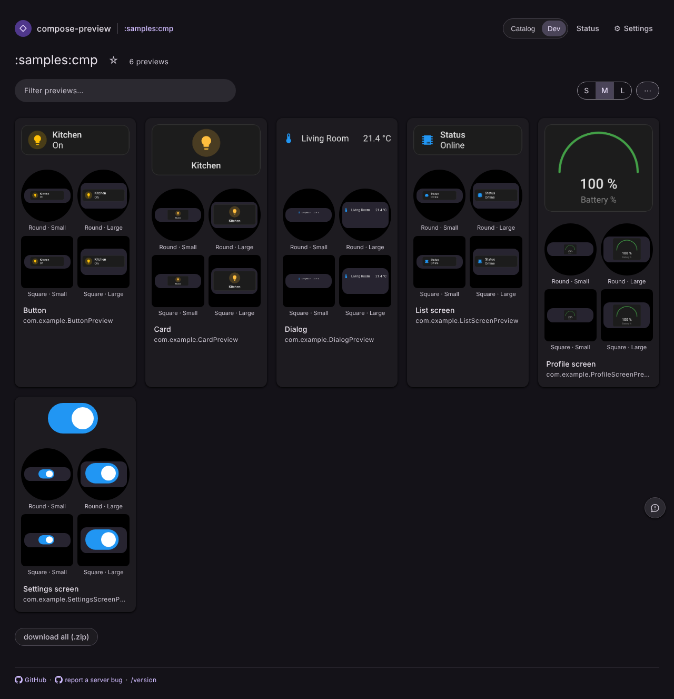
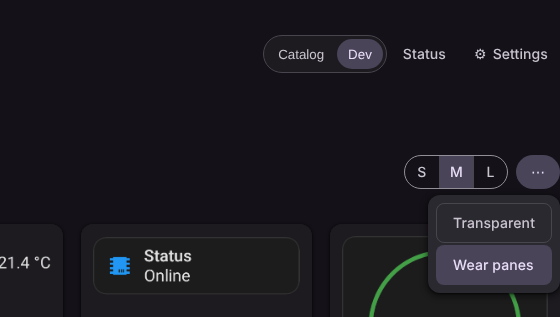
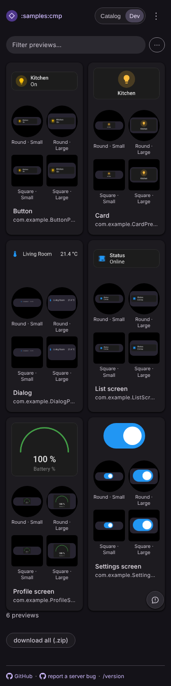
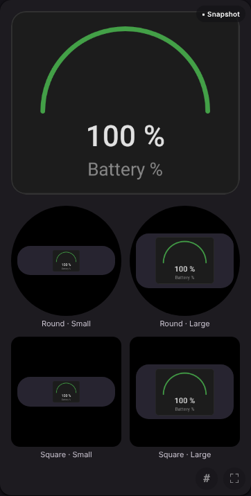
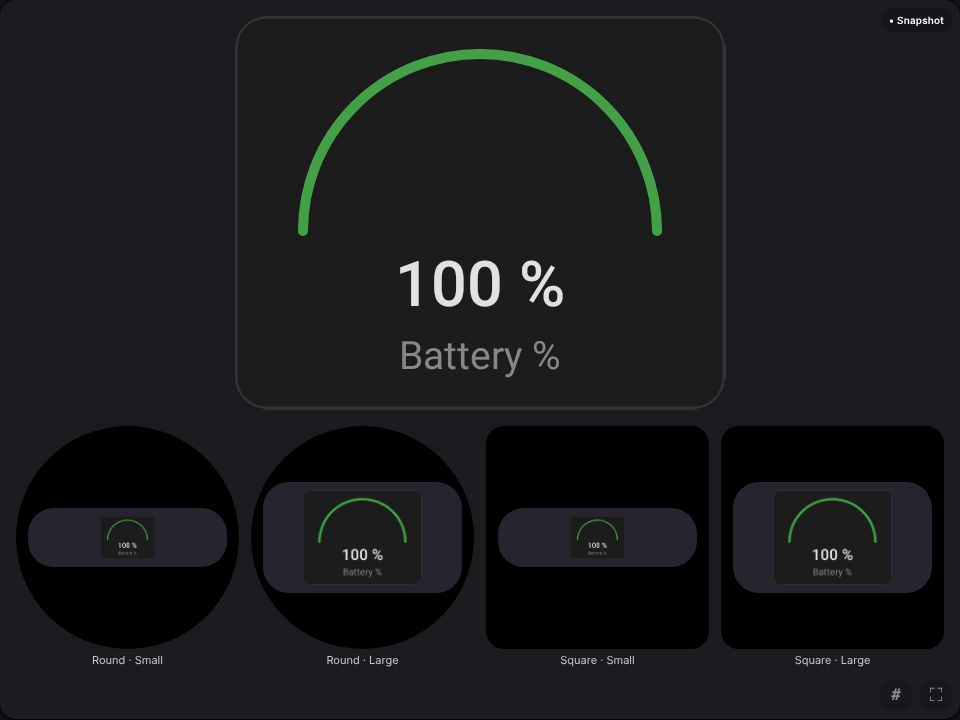
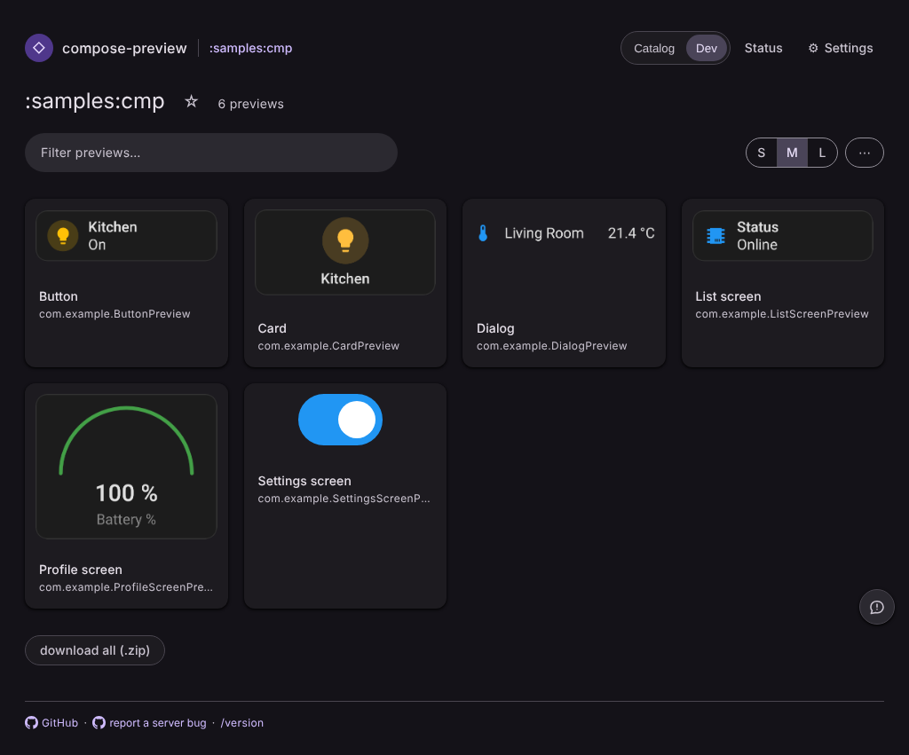

# Wear panes: each preview in approximate watch screens

An opt-in **Wear panes** chip beside Transparent (the catalog's `⋯` panel, the viewer's View group),
off by default and remembered per visitor in `localStorage` (`cp-wear-panes.v1`). When on, every
preview the page lists is also laid into a **round** and a **square** watch screen, in the Wear
widget host's **Small** (200 × 60 dp) and **Large** (200 × 112 dp) containers: 26 dp corners,
`rgb(39, 36, 48)`, 8 dp padding, on black, with the render `object-fit: contain`ed into the content
box. The dp sizes are fractions of a nominal 225 dp screen, so the set scales to the space it has.

It is HTML and CSS around the PNGs the catalog already serves: no new render, no device frame.

Captured with Playwright (Chromium 1194, dark scheme, device scale 1) over the committed
`serve-landing` and `serve-viewer` page fixtures, with the fixture's `/render/*.png` stubbed by real
`homeassistant-remotecompose` card renders (Tile, Button, Entity, Gauge, Toggle) standing in for the
`Design/...` library designs that catalog will publish.

| catalog, toggle on (1280 px) | the toggle |
| --- | --- |
|  |  |

| catalog, phone (390 px) | viewer, phone (390 px) |
| --- | --- |
|  |  |

| viewer stage, toggle on | catalog, toggle off (unchanged) |
| --- | --- |
|  |  |

Measured in the same run: no horizontal page scroll at 390 px or at desktop width, four panes per
card and one set on the viewer stage, and each container's computed size is 200 × 60 / 200 × 112 dp
with 26 dp corners and 8 dp padding against its screen's 225 dp.
